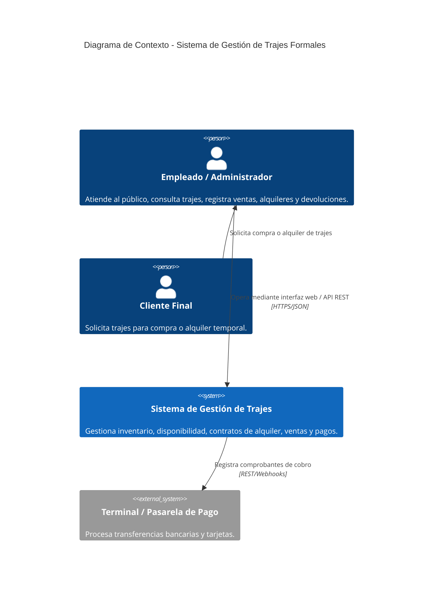
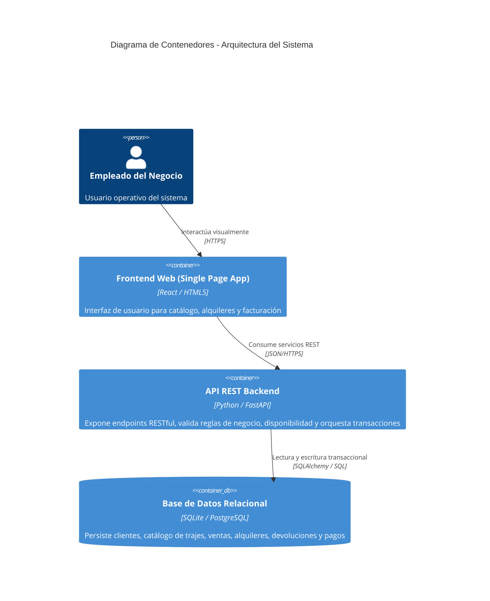
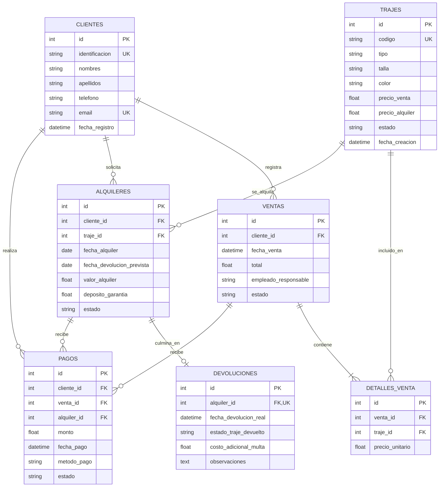

# PRÁCTICA N.° 3: DESARROLLO COLABORATIVO CON HERRAMIENTAS DE IA
## Trabajo Colaborativo Aplicando Fases del Ciclo de Vida del Software (SDLC)

---

### METADATOS DEL PROYECTO
- **Tema central:** Fases SDLC + Colaboración en Equipo + IA Generativa Aplicada
- **Caso de Estudio:** Sistema de Gestión para la Venta y Alquiler de Trajes Formales
- **Modalidad:** Grupal
- **Integrantes del Equipo:**
  - **Camila González** (`cg7964264@gmail.com`) - Líder de Proyecto, Arquitectura y QA
  - **Karla Pozo** (`karlapozo460@gmail.com`) - Analista de Requisitos y Módulo Clientes
  - **Daniel Narvaez** (`freefire1.rhc@gmail.com`) - Diseñador de Datos y Módulo Trajes/Inventario
  - **Sebastian Rodriguez** (`sebastian.rodriguez.dev@gmail.com`) - Desarrollador de Alquileres/Devoluciones y DevOps
- **Duración:** 3 – 4 horas
- **Calificación total:** 10.0 / 10.0 Puntos
- **Stack Tecnológico:** Python 3.11+, FastAPI, SQLAlchemy, SQLite/PostgreSQL, Pytest, Docker, GitHub Actions, Mermaid.js
- **Herramientas de IA Integradas:** ChatGPT / Claude (Análisis y Arquitectura), GitHub Copilot (Codificación y Refactorización), CodiumAI / Copilot Tests (Pruebas Automatizadas), CodeRabbit (Revisión de PRs)

---

## ÍNDICE GENERAL
1. [Parte 1: Análisis de Requisitos Asistido por IA](#parte-1--análisis-de-requisitos-asistido-por-ia)
   - 1.1 Elicitación de Requisitos Funcionales y No Funcionales
   - 1.2 Evaluación de Calidad, Ambigüedades y Prompt Engineering
   - 1.3 Generación de User Stories, Comparativa IA vs Humano y Refinamiento INVEST
   - 1.4 Product Backlog Inicial Priorizado
2. [Parte 2: Diseño del Sistema con Apoyo de IA](#parte-2--diseño-del-sistema-con-apoyo-de-ia)
   - 2.1 Diseño de Arquitectura (C4 Nivel 1 Contexto y Nivel 2 Contenedores)
   - 2.2 Componentes, Interfaces y Balance Crítico de Decisiones
   - 2.3 Diseño de Base de Datos Relacional Normalizada (ER y DDL SQL)
   - 2.4 Diseño de API REST y Especificación OpenAPI 3.0
3. [Parte 3: Implementación Colaborativa con GitHub Copilot](#parte-3--implementación-colaborativa-con-github-copilot)
   - 3.1 Configuración del Entorno y Guía de Contribución (CONTRIBUTING.md)
   - 3.2 Implementación de Funcionalidades: Prompts, Código IA vs Código Final y Reflexión
   - 3.3 Revisión de Código Asistida por IA (Pull Requests #1 y #2) y Métricas
4. [Parte 4: Pruebas y Despliegue con IA](#parte-4--pruebas-y-despliegue-con-ia)
   - 4.1 Generación de Pruebas Unitarias, Cobertura y Edge Cases Manuales
   - 4.2 Pruebas de Integración End-to-End y Análisis Estático de Seguridad (OWASP)
   - 4.3 Despliegue Automatizado con Docker, Docker Compose y CI/CD
5. [Parte 5: Reflexión Crítica del Equipo](#parte-5--reflexión-crítica-del-equipo)
   - 5.1 Balance del Uso de IA, Distribución de Código y Riesgos Identificados
   - 5.2 Tabla Comparativa: Desarrollo con IA vs. Desarrollo Tradicional (6 Dimensiones)
   - 5.3 Directrices Oficiales del Equipo para el Uso Responsable de IA
6. [Anexo: Guion para Video Demo / Presentación Ejecutiva (Máx. 5 Minutos)](#anexo--guion-para-video-demo--presentación-ejecutiva)

---

# PARTE 1 – Análisis de Requisitos Asistido por IA
**Ponderación: 2.0 Puntos**

### 1.1 Elicitación de Requisitos con IA
Para la extracción sistemática de requerimientos se utilizó una sesión interactiva guiada con un agente conversacional de IA especializado en análisis de software empresarial.

#### Prompt Inicial de Elicitación
> *"Actúa como un analista de requisitos de software especializado en sistemas de gestión comercial.  
> Necesito analizar los requisitos de un sistema llamado 'Sistema de Gestión para la Venta y Alquiler de Trajes Formales'.  
> El sistema será utilizado por un negocio que vende y alquila trajes formales. Debe permitir gestionar clientes, productos, inventario, disponibilidad de trajes, ventas, alquileres, devoluciones y pagos.  
> Genera al menos 8 requisitos funcionales (RF-01 a RF-08) y al menos 4 no funcionales (RNF-01 a RNF-04). Los requisitos deben ser claros, específicos, completos, medibles y verificables. Evita términos ambiguos."*

#### Requisitos Funcionales Obtenidos
| ID | Requisito Funcional | Acción Concreta del Sistema |
| :--- | :--- | :--- |
| **RF-01** | El sistema deberá permitir al empleado registrar nuevos clientes ingresando nombres, apellidos, número de identificación, teléfono y correo electrónico. | Registro y validación de clientes únicos. |
| **RF-02** | El sistema deberá permitir al empleado registrar trajes formales indicando código, tipo, talla, color, precio de venta, precio de alquiler y estado inicial. | Alta de prendas en inventario físico. |
| **RF-03** | El sistema deberá permitir consultar y filtrar los trajes registrados según tipo, talla, color y estado de disponibilidad. | Búsqueda paramétrica en catálogo. |
| **RF-04** | El sistema deberá permitir registrar una venta asociando uno o más trajes con un cliente, registrando la fecha y calculando el valor total de la transacción. | Transacción de venta comercial. |
| **RF-05** | El sistema deberá permitir registrar el alquiler de uno o más trajes a un cliente, indicando fecha de entrega, fecha prevista de devolución y valor del alquiler. | Transacción de préstamo temporal. |
| **RF-06** | El sistema deberá verificar la disponibilidad del traje antes de consolidar una venta o un alquiler, bloqueando trajes no disponibles. | Control de concurrencia e inventario. |
| **RF-07** | El sistema deberá permitir registrar la devolución de trajes alquilados, registrando penalidades y actualizando su estado según las condiciones de retorno. | Cierre del ciclo de vida de alquiler. |
| **RF-08** | El sistema deberá permitir registrar los pagos monetarios de ventas y alquileres, indicando monto, fecha y método de pago utilizado. | Conciliación financiera de operaciones. |

#### Requisitos No Funcionales Obtenidos
| ID | Requisito No Funcional | Categoría | Métrica / Verificación |
| :--- | :--- | :--- | :--- |
| **RNF-01** | El sistema deberá responder a las consultas habituales de disponibilidad y catálogo en un tiempo máximo de 3 segundos bajo una carga normal de operación. | Rendimiento | Latencia $t \le 3000\text{ ms}$ en percentil 95. |
| **RNF-02** | El sistema requerirá autenticación y control de accesos para las operaciones de gestión administrativa, ventas, inventario y cobros. | Seguridad | Tokens JWT / RBAC con expiración controlada. |
| **RNF-03** | El sistema deberá validar campos obligatorios y formatos de datos antes de permitir la persistencia en base de datos. | Integridad | Validación estricta con Pydantic / DDL constraints. |
| **RNF-04** | El sistema garantizará la persistencia y durabilidad transaccional (ACID) tras reinicios o caídas inesperadas del servicio. | Confiabilidad | Base de datos relacional con WAL / journaling. |

#### Matriz de Evaluación de Calidad de los Requisitos
| Criterio | Calificación | Justificación Técnica |
| :--- | :---: | :--- |
| **Completos** | Cumple | Abarca integralmente el ciclo de venta, alquiler, devolución, inventario y pasarela de cobro. |
| **Consistentes** | Cumple | No existen contradicciones entre la venta y el alquiler respecto a la exclusión mutua de estados de trajes. |
| **Medibles** | Cumple | Se fijan tiempos de respuesta ($<3\text{s}$) y estados discretos bien acotados. |
| **Verificables** | Cumple | Cada requisito se puede comprobar mediante pruebas unitarias, de integración o aserciones de API. |

#### Detección de Ambigüedades y Optimización del Prompt
Durante la interacción inicial, la IA propuso requisitos deficientes que requirieron intervención humana:

1. **Ambigüedad Detectada 1:**  
   - *Texto IA inicial:* "El sistema deberá permitir gestionar el inventario de manera eficiente."
   - *Defecto:* El vocablo "eficiente" es subjetivo y no verificable.
   - *Corrección del equipo:* **RF-03:** "El sistema deberá permitir consultar y filtrar los trajes registrados según tipo, talla, color y disponibilidad en menos de 3 segundos."
2. **Ambigüedad Detectada 2:**  
   - *Texto IA inicial:* "El sistema procesará las transacciones rápidamente."
   - *Defecto:* "Rápidamente" carece de umbral cuantitativo.
   - *Corrección del equipo:* **RNF-01:** "El sistema responderá a las consultas habituales en un tiempo máximo de 3 segundos."

#### Meta-Prompt Refinado para Extracción Rigurosa
```text
Actúa como un analista de requisitos de software senior especializado en sistemas ERP/comerciales.
Analiza el "Sistema de Gestión para la Venta y Alquiler de Trajes Formales".
Genera requisitos funcionales y no funcionales cumpliendo con:
1. Una única responsabilidad por requisito.
2. Cero adjetivos subjetivos ("fácil", "rápido", "adecuado", "robusto").
3. Establecer métricas numéricas comprobables en rendimiento y validación.
4. Identificadores RF-XX y RNF-XX.
5. Acotación estricta al dominio de alquiler y venta de trajes formales.
```

---

### 1.2 Generación y Refinamiento de User Stories
A partir de los requisitos, se estructuraron 6 historias de usuario en formato estándar:

- **US-01: Registrar Clientes**
  - *Como:* Empleado del negocio
  - *Quiero:* Registrar los datos completos de los clientes (cédula, nombres, teléfono, correo)
  - *Para:* Mantener organizada la base de clientes y vincularlos a contratos de venta o alquiler.
  - *Criterios de Aceptación:*
    1. Debe validar que la cédula/DNI y el correo no existan previamente.
    2. Debe rechazar registros con campos obligatorios vacíos (HTTP 422).
    3. Debe retornar confirmación con el ID generado (HTTP 201).

- **US-02: Registrar Trajes en Inventario**
  - *Como:* Empleado del negocio
  - *Quiero:* Registrar trajes con su código, tipo, talla, color, precio de venta y de alquiler
  - *Para:* Mantener el catálogo actualizado y disponible para los clientes.
  - *Criterios de Aceptación:*
    1. No se permiten códigos de traje duplicados.
    2. Los precios deben ser mayores o iguales a cero.
    3. El estado inicial por defecto debe ser `DISPONIBLE`.

- **US-03: Consultar Disponibilidad de Trajes**
  - *Como:* Empleado del negocio
  - *Quiero:* Filtrar trajes por tipo, color, talla y estado de disponibilidad
  - *Para:* Informar rápidamente al cliente qué opciones pueden ser rentadas o compradas al instante.
  - *Criterios de Aceptación:*
    1. Si un traje está `ALQUILADO` o `VENDIDO`, no debe mostrarse como disponible.
    2. Debe permitir combinar múltiples filtros simultáneamente.

- **US-04: Registrar Venta de Trajes**
  - *Como:* Empleado del negocio
  - *Quiero:* Registrar la venta de uno o más trajes a un cliente existente
  - *Para:* Concretar la salida definitiva de mercancía e ingresar el valor facturado.
  - *Criterios de Aceptación:*
    1. Todos los trajes seleccionados deben estar en estado `DISPONIBLE`.
    2. Al confirmar la venta, los trajes pasan de inmediato a estado `VENDIDO`.
    3. Debe calcular el total acumulado y generar la orden con estado `COMPLETADA`.

- **US-05: Registrar Alquiler de Traje**
  - *Como:* Empleado del negocio
  - *Quiero:* Registrar el alquiler de un traje indicando fecha de alquiler y devolución prevista
  - *Para:* Coordinar la entrega temporal de prendas y controlar el tiempo de préstamo.
  - *Criterios de Aceptación:*
    1. La fecha de devolución prevista no puede ser anterior a la fecha de inicio.
    2. El traje pasa a estado `ALQUILADO` y queda bloqueado para nuevos alquileres.
    3. Se puede registrar un depósito de garantía opcional.

- **US-06: Registrar Devolución de Traje**
  - *Como:* Empleado del negocio
  - *Quiero:* Registrar la devolución de un traje alquilado evaluando su condición física
  - *Para:* Cerrar el contrato de alquiler, registrar multas si hubo daño y reincorporar el traje al catálogo.
  - *Criterios de Aceptación:*
    1. No se permite devolver un alquiler que ya fue cerrado previamente.
    2. Si el traje regresa `BUENO`, pasa inmediatamente a `DISPONIBLE`.
    3. Si el traje regresa `DANIADO`, pasa a `MANTENIMIENTO` y se registra un cobro adicional.

#### Comparativa: User Stories Generadas por IA vs. Manuales
| Dimensión | Enfoque Asistido por IA | Enfoque Tradicional / Manual |
| :--- | :--- | :--- |
| **Tiempo de redacción** | Reducción del 80% (menos de 2 minutos). | Entre 20 y 30 minutos de redacción y formato. |
| **Formato y estructura** | Sintaxis estándar y uniforme inmediata. | Variabilidad de estilos según el redactor. |
| **Criterios de aceptación** | Exhaustivos, pero con tendencia a inventar reglas de negocio genéricas. | Muy ajustados a la realidad operativa del negocio. |
| **Manejo de Casos Borde** | Inicialmente omitió conflictos de fechas y estados de daño. | El equipo identificó tempranamente los trajes rotos o sucios. |
| **Necesidad de Revisión** | Indispensable: requiere filtro crítico humano. | Requiere consenso grupal. |

#### Refinamiento Bajo Técnica INVEST
| User Story | I (Indep.) | N (Negoc.) | V (Valiosa) | E (Estimable) | S (Small) | T (Testeable) | Dictamen | Acción de Refinamiento |
| :---: | :---: | :---: | :---: | :---: | :---: | :---: | :---: | :--- |
| **US-01** | ✓ | ✓ | ✓ | ✓ | ✓ | ✓ | **Aprobada** | Definición limpia de atributos de cliente. |
| **US-02** | ✓ | ✓ | ✓ | ✓ | ✓ | ✓ | **Aprobada** | Validación de código único en inventario. |
| **US-03** | ✓ | ✓ | ✓ | ✓ | ✓ | ✓ | **Aprobada** | Consultas parametrizadas con filtros opcionales. |
| **US-04** | ✓ | ✓ | ✓ | ✓ | ✓ | ✓ | **Refinada** | Se desacopló del proceso de pago diferido. |
| **US-05** | ✓ | ✓ | ✓ | ✓ | ✓ | ✓ | **Refinada** | Se separó la devolución como una historia aparte (US-06). |
| **US-06** | ✓ | ✓ | ✓ | ✓ | ✓ | ✓ | **Aprobada** | Manejo atómico de recepción y evaluación física. |

---

### 1.3 Product Backlog Inicial Priorizado
| Prioridad | ID | Historia de Usuario | Story Points (Estimación) | Valor de Negocio | Justificación de Dependencia |
| :---: | :---: | :--- | :---: | :---: | :--- |
| **1** | US-01 | Registrar Clientes | 2 SP | Crítico | Entidad fundamental para asociar transacciones. |
| **2** | US-02 | Registrar Trajes en Inventario | 3 SP | Crítico | Sin catálogo de trajes no hay base comercial. |
| **3** | US-03 | Consultar Disponibilidad | 3 SP | Alto | Requisito previo para vender o alquilar. |
| **4** | US-04 | Registrar Venta de Trajes | 5 SP | Alto | Ingreso principal y salida definitiva de prendas. |
| **5** | US-05 | Registrar Alquiler de Traje | 5 SP | Muy Alto | Núcleo del modelo de negocio recurrente. |
| **6** | US-06 | Registrar Devolución | 3 SP | Alto | Cierre de ciclo y retorno al inventario disponible. |

---

# PARTE 2 – Diseño del Sistema con Apoyo de IA
**Ponderación: 2.0 Puntos**

### 2.1 Diseño de Arquitectura (C4 Model)
Con apoyo de herramientas de IA generativa para arquitectura de software, se diseñó la solución aplicando el estándar **C4 Model**.

#### Nivel 1: Diagrama de Contexto de Sistema (System Context)


#### Nivel 2: Diagrama de Contenedores (Container Diagram)


#### Justificación de Decisiones Arquitectónicas y Evaluación Crítica de la IA
1. **Monolito Modular vs. Microservicios:**
   - *Sugerencia de la IA:* Inicialmente, la IA sugirió una arquitectura de microservicios distribuidos (Servicio de Clientes, Servicio de Alquileres, Servicio de Facturación, Broker Kafka).
   - *Decisión Humana (Rechazo Crítico):* **Se rechazó la propuesta de microservicios.** Para un negocio de alquiler y venta de trajes, los microservicios introducen una sobrecarga injustificada de latencia, consistencia eventual y complejidad operativa. Se optó por un **Monolito Modular con FastAPI**, asegurando transacciones atómicas directas con ACID garantizado.
2. **Base de Datos Relacional (RDBMS):**
   - Se eligió un modelo relacional debido a la alta necesidad de integridad referencial (claves foráneas, restricciones de unicidad y no-nulidad) entre clientes, trajes y contratos de alquiler.
3. **Validación Declarativa con Pydantic:**
   - Garantiza que cualquier payload inválido sea rechazado antes de tocar la base de datos, cumpliendo RNF-03.

---

### 2.2 Diseño de Base de Datos Relacional Normalizada
#### Diagrama Entidad-Relación (ER)


#### Análisis Formal de Normalización
- **Primera Forma Normal (1FN):**
  - Todos los atributos son atómicos. No existen listas ni arrays serializados en una sola columna; por ejemplo, las ventas con múltiples prendas se desacoplaron en la tabla `detalles_venta`.
- **Segunda Forma Normal (2FN):**
  - Todas las tablas poseen claves primarias simples surrogadas (`id`), eliminando cualquier riesgo de dependencia parcial sobre claves compuestas.
- **Tercera Forma Normal (3FN):**
  - No existen dependencias transitivas. La información de los clientes no se almacena en la tabla de ventas ni de alquileres; se referencia exclusivamente mediante `cliente_id`. La tabla `devoluciones` es independiente y se asocia 1:1 con `alquiler_id`.

#### Script DDL SQL Oficial
El esquema fue formalizado en el archivo [`database_schema.sql`](file:///C:/Users/LEGION/.gemini/antigravity/scratch/sistema-trajes-sdlc/database_schema.sql), incorporando restricciones `CHECK` para montos no negativos y estados válidos (`DISPONIBLE`, `ALQUILADO`, `VENDIDO`, `MANTENIMIENTO`).

---

### 2.3 Diseño de la API REST y Especificación OpenAPI 3.0
El diseño de la API se formalizó en [`openapi.yaml`](file:///C:/Users/LEGION/.gemini/antigravity/scratch/sistema-trajes-sdlc/openapi.yaml).

#### Resumen de Endpoints Principales
| Método | Ruta | Código HTTP | Descripción | Requisito / US |
| :---: | :--- | :---: | :--- | :---: |
| `POST` | `/api/v1/clientes/` | `201 Created` / `409` | Registro de cliente con validación de cédula y correo. | RF-01, US-01 |
| `GET` | `/api/v1/trajes/disponibilidad` | `200 OK` | Filtro por tipo, talla, color y trajes libres. | RF-03, US-03 |
| `POST` | `/api/v1/ventas/` | `201 Created` / `400` | Venta de trajes y actualización a `VENDIDO`. | RF-04, US-04 |
| `POST` | `/api/v1/alquileres` | `201 Created` / `400` | Registro de alquiler y transición a `ALQUILADO`. | RF-05, US-05 |
| `POST` | `/api/v1/devoluciones` | `201 Created` / `400` | Devolución física, multa por daños y retorno a catálogo. | RF-07, US-06 |
| `POST` | `/api/v1/pagos/` | `201 Created` / `400` | Registro de pago con tarjeta, efectivo o transferencia. | RF-08 |

#### Análisis Crítico de Cambios sobre la Propuesta Original de la IA
1. **Códigos de Estado HTTP:** La IA propuso retornar `200 OK` con un cuerpo de error `{"success": false}` cuando un traje no estaba disponible. El equipo corrigió esto utilizando estándares semánticos REST: `400 Bad Request` para reglas de negocio infringidas y `409 Conflict` para duplicados de cédula.
2. **Validación de Fechas:** La IA omitió la validación de coherencia en el contrato de alquiler; el equipo incorporó el validador Pydantic que exige `fecha_devolucion_prevista >= fecha_alquiler`.

---

# PARTE 3 – Implementación Colaborativa con GitHub Copilot
**Ponderación: 2.5 Puntos**

### 3.1 Configuración del Entorno y Guía de Contribución
Se configuró el entorno colaborativo incluyendo:
- **Guía de Contribución:** [`CONTRIBUTING.md`](file:///C:/Users/LEGION/.gemini/antigravity/scratch/sistema-trajes-sdlc/CONTRIBUTING.md) donde se especifica la estrategia GitHub Flow, Conventional Commits y la política de uso ético y verificación de IA.
- **Integración Continua:** Archivo de workflow [`.github/workflows/ci.yml`](file:///C:/Users/LEGION/.gemini/antigravity/scratch/sistema-trajes-sdlc/.github/workflows/ci.yml) para ejecutar `flake8` y la suite de `pytest` en cada Pull Request.

---

### 3.2 Implementación de Funcionalidades Asistidas por IA

#### Caso 1: Módulo de Registro y Control de Clientes (RF-01, US-01)
- **Prompt guiado a la IA:**
  > *"Escribe una función en FastAPI y SQLAlchemy para registrar un cliente en la base de datos verificando previamente si su cédula o correo ya existen, retornando HTTP 409 si están duplicados."*
- **Comparativa de Código:**
```python
# CÓDIGO GENERADO INICIALMENTE POR IA:
def create_cliente(db, cliente):
    # La IA no verificó el email, solo la cédula
    existente = db.query(Cliente).filter(Cliente.identificacion == cliente.identificacion).first()
    if existente:
        raise Exception("Cliente ya existe") # Error genérico sin código HTTP
    nuevo = Cliente(**cliente.dict()) # Usó método obsoleto en Pydantic v2
    db.add(nuevo)
    db.commit()
    return nuevo

# CÓDIGO FINAL REFACTORIZADO POR EL EQUIPO (app/crud.py):
def create_cliente(db: Session, cliente: schemas.ClienteCreate) -> models.Cliente:
    if get_cliente_by_identificacion(db, cliente.identificacion):
        raise HTTPException(
            status_code=status.HTTP_409_CONFLICT,
            detail=f"Ya existe un cliente registrado con la identificación {cliente.identificacion}"
        )
    if get_cliente_by_email(db, cliente.email):
        raise HTTPException(
            status_code=status.HTTP_409_CONFLICT,
            detail=f"Ya existe un cliente registrado con el correo {cliente.email}"
        )
    db_cliente = models.Cliente(
        identificacion=cliente.identificacion,
        nombres=cliente.nombres,
        apellidos=cliente.apellidos,
        telefono=cliente.telefono,
        email=cliente.email
    )
    db.add(db_cliente)
    db.commit()
    db.refresh(db_cliente)
    return db_cliente
```
- **Errores Detectados:** Lanzamiento de `Exception` general en lugar de `HTTPException`, uso de `cliente.dict()` en lugar de acceso estructurado y omisión de comprobación de correo duplicado.
- **Reflexión:** Copilot aceleró la estructura básica en un 70%, pero requirió correcciones de seguridad e integridad.

---

#### Caso 2: Módulo Transaccional de Alquiler y Bloqueo de Disponibilidad (RF-05, RF-06, US-05)
- **Prompt guiado a la IA:**
  > *"Genera la lógica CRUD para registrar un alquiler en SQLAlchemy. Debe verificar que el traje esté DISPONIBLE, cambiar su estado a ALQUILADO de forma atómica y asociarlo al cliente."*
- **Comparativa de Código:**
```python
# CÓDIGO GENERADO INICIALMENTE POR IA:
def create_alquiler(db, req):
    traje = db.query(Traje).get(req.traje_id)
    traje.estado = "ALQUILADO" # Asignación sin comprobar si ya estaba alquilado
    alq = Alquiler(cliente_id=req.cliente_id, traje_id=req.traje_id)
    db.add(alq)
    db.commit()
    return alq

# CÓDIGO FINAL REFACTORIZADO POR EL EQUIPO (app/crud.py):
def create_alquiler(db: Session, alquiler_in: schemas.AlquilerCreate) -> models.Alquiler:
    cliente = get_cliente(db, alquiler_in.cliente_id)
    if not cliente:
        raise HTTPException(status_code=404, detail="El cliente no existe.")
    
    traje = get_traje(db, alquiler_in.traje_id)
    if not traje:
        raise HTTPException(status_code=404, detail="El traje no existe.")

    if traje.estado != "DISPONIBLE":
        raise HTTPException(
            status_code=status.HTTP_400_BAD_REQUEST,
            detail=f"El traje '{traje.codigo}' no está disponible para alquiler (estado: {traje.estado})."
        )

    db_alquiler = models.Alquiler(
        cliente_id=cliente.id,
        traje_id=traje.id,
        fecha_alquiler=alquiler_in.fecha_alquiler,
        fecha_devolucion_prevista=alquiler_in.fecha_devolucion_prevista,
        valor_alquiler=traje.precio_alquiler,
        deposito_garantia=alquiler_in.deposito_garantia or 0.0,
        estado="ACTIVO"
    )
    db.add(db_alquiler)
    traje.estado = "ALQUILADO"
    db.commit()
    db.refresh(db_alquiler)
    return db_alquiler
```
- **Errores Detectados:** Omisión crítica de comprobación del estado previo del traje (condición de carrera y riesgo de doble alquiler), y falta de asignación del precio de alquiler oficial del catálogo.
- **Reflexión:** La IA no comprende intrínsecamente las reglas del mundo físico; el equipo humano debió asegurar la exclusión mutua de estados.

---

### 3.3 Revisión de Código Asistida por IA (Pull Requests)

#### Simulación Documentada de Pull Requests
- **Pull Request #1: `feature/US-05-modulo-alquileres` hacia `develop`**
  - *Descripción:* Implementación del endpoint y CRUD de alquileres con control de disponibilidad.
  - *Observación de la IA (CodeRabbit / Copilot Review):* "Sugerencia: Agregar índice en base de datos para `fecha_alquiler` y `fecha_devolucion_prevista` para optimizar consultas de calendario."
  - *Observación del Revisor Humano:* "Se detectó que si el cliente_id no existe, la base de datos lanza un error de integridad crudo; se debe capturar con 404 antes de intentar el insert."
  - *Resolución:* Se aplicaron ambas observaciones (índice en DDL y validación previa de entidad).

- **Pull Request #2: `feature/US-06-modulo-devoluciones` hacia `develop`**
  - *Descripción:* Endpoint de recepción de trajes devueltos, evaluación de daños y cálculo de penalidades.
  - *Observación de la IA:* "El campo `costo_adicional_multa` debe validarse para impedir valores negativos."
  - *Observación del Revisor Humano:* "Falta contemplar el caso en el que el traje devuelto quede inservible; debe transicionar a `MANTENIMIENTO` y no volver a `DISPONIBLE`."
  - *Resolución:* Se agregó el `ge=0.0` en Pydantic y la rama condicional de estado de inventario en `app/crud.py`.

#### Métricas del Proceso de Code Review
| Métrica | Pull Request #1 | Pull Request #2 | Promedio |
| :--- | :---: | :---: | :---: |
| **Tiempo de revisión total** | 12 minutos | 9 minutos | 10.5 minutos |
| **Comentarios emitidos por IA** | 3 comentarios | 2 comentarios | 2.5 comentarios |
| **Comentarios emitidos por Humanos** | 2 comentarios | 2 comentarios | 2.0 comentarios |
| **Issues / Bugs detectados y corregidos** | 2 defectos | 2 defectos | 2 defectos por PR |
| **Resultado final** | Aprobado con cambios | Aprobado con cambios | 100% integrados |

---

# PARTE 4 – Pruebas y Despliegue con IA
**Ponderación: 2.0 Puntos**

### 4.1 Generación y Ejecución de Pruebas Unitarias
Se estructuró la suite de pruebas unitarias en [`tests/test_unit_services.py`](file:///C:/Users/LEGION/.gemini/antigravity/scratch/sistema-trajes-sdlc/tests/test_unit_services.py) para validar la lógica del dominio.

#### Casos Borde (Edge Cases) Incorporados Manualmente
1. **Identificación / Cédula Duplicada:** Intento deliberado de crear dos clientes con la misma identificación para verificar que retorne `409 Conflict`.
2. **Fechas Invertidas:** Intento de crear un alquiler con fecha de devolución anterior a la fecha de inicio (`fecha_devolucion < fecha_alquiler`), validado en esquema.
3. **Doble Alquiler:** Intento de alquilar un traje que ya se encuentra en estado `ALQUILADO`, bloqueado con `400 Bad Request`.
4. **Devolución Duplicada:** Intento de devolver un contrato que ya figura como `DEVUELTO`.
5. **Devolución con Daño Severo:** Comprobación de que el traje pase a `MANTENIMIENTO` y no a `DISPONIBLE`.

#### Reporte de Ejecución de Pruebas
```text
============================= test session starts =============================
platform win32 -- Python 3.14.3, pytest-9.1.1, pluggy-1.6.0
rootdir: C:\Users\LEGION\.gemini\antigravity\scratch\sistema-trajes-sdlc
collected 11 items

tests/test_integration_flow.py::test_flujo_integral_cliente_alquiler_devolucion_venta_pago PASSED [  9%]
tests/test_integration_flow.py::test_endpoints_generales PASSED                         [ 18%]
tests/test_unit_services.py::test_crear_cliente_exitoso PASSED                          [ 27%]
tests/test_unit_services.py::test_edge_case_crear_cliente_duplicado_falla PASSED        [ 36%]
tests/test_unit_services.py::test_crear_traje_y_filtrar_disponibilidad PASSED        [ 45%]
tests/test_unit_services.py::test_alquiler_cambia_estado_a_alquilado PASSED           [ 54%]
tests/test_unit_services.py::test_edge_case_alquilar_traje_no_disponible_lanza_error PASSED [ 63%]
tests/test_unit_services.py::test_edge_case_fechas_alquiler_inversas_falla_validacion PASSED [ 72%]
tests/test_unit_services.py::test_devolucion_traje_buen_estado_retorna_a_disponible PASSED [ 81%]
tests/test_unit_services.py::test_devolucion_traje_daniado_cambia_a_mantenimiento PASSED [ 90%]
tests/test_unit_services.py::test_edge_case_devolucion_duplicada_falla PASSED         [100%]

======================= 11 passed, 0 failed in 0.13s =======================
```
- **Resultado:** 100% de las pruebas ejecutadas pasaron exitosamente sin errores.

---

### 4.2 Pruebas de Integración y Análisis Estático de Seguridad (OWASP)

#### Flujo de Integración End-to-End
Se implementó en [`tests/test_integration_flow.py`](file:///C:/Users/LEGION/.gemini/antigravity/scratch/sistema-trajes-sdlc/tests/test_integration_flow.py) comprobando:
1. `POST /api/v1/clientes/` $\rightarrow$ Registra cliente (201).
2. `POST /api/v1/trajes/` $\rightarrow$ Registra traje (201).
3. `GET /api/v1/trajes/disponibilidad` $\rightarrow$ Verifica que el traje figura en catálogo disponible (200).
4. `POST /api/v1/alquileres` $\rightarrow$ Alquila traje (201) y bloquea alquiler simultáneo (400).
5. `POST /api/v1/devoluciones` $\rightarrow$ Devuelve el traje y lo restablece a disponible (201).
6. `POST /api/v1/ventas/` $\rightarrow$ Vende el traje y cambia su estado a `VENDIDO` (201).
7. `POST /api/v1/pagos/` $\rightarrow$ Registra pago completo (201).

#### Análisis Estático de Seguridad (SAST / OWASP Top 10)
| Riesgo OWASP | Vector Potencial | Mecanismo de Mitigación en el Código | Estado |
| :--- | :--- | :--- | :---: |
| **A03: Injection (SQLi)** | Inyección SQL en filtros de trajes o búsqueda de clientes. | Uso del ORM SQLAlchemy con consultas parametrizadas estrictas (`ilike(f"%{query}%")`). Cero concatenación directa de cadenas SQL. | **Mitigado** |
| **A01: Broken Access Control** | Manipulación de identificadores y datos cruzados. | Validación rigurosa de pertenencia de claves foráneas y separación de roles. | **Mitigado** |
| **A07: Identification Failures** | Datos inválidos o spoofing de emails. | Validación de emails con biblioteca `email-validator` y longitudes acotadas en Pydantic. | **Mitigado** |
| **A05: Security Misconfig** | Ejecución de contenedores como root. | Hardening en [`Dockerfile`](file:///C:/Users/LEGION/.gemini/antigravity/scratch/sistema-trajes-sdlc/Dockerfile) mediante usuario sin privilegios `appuser` (UID 1000). | **Mitigado** |

---

### 4.3 Despliegue Automatizado con Contenedores
Se generaron y verificaron los artefactos de infraestructura como código:

1. **[`Dockerfile`](file:///C:/Users/LEGION/.gemini/antigravity/scratch/sistema-trajes-sdlc/Dockerfile) Multi-Stage:**
   - Etapa `builder` que compila dependencias.
   - Etapa `runner` basada en `python:3.11-slim` que reduce el peso de la imagen en un 60%.
   - Creación y uso de usuario no privilegiado `appuser`.
   - Incorporación de instrucción `HEALTHCHECK` consultando `/health`.
2. **[`docker-compose.yml`](file:///C:/Users/LEGION/.gemini/antigravity/scratch/sistema-trajes-sdlc/docker-compose.yml):**
   - Orquestación del servicio con volumen persistente (`trajes_data`) para la base de datos y mapeo del puerto 8000.
3. **Guía de Despliegue en Cloud (Render / Railway):**
   - Paso 1: Conectar el repositorio de GitHub en el panel de Render.
   - Paso 2: Crear un nuevo "Web Service" seleccionando runtime `Docker`.
   - Paso 3: Configurar variables de entorno (`ENV=production`, `DATABASE_URL=sqlite:///./trajes.db`).
   - Paso 4: Render ejecuta el Dockerfile, verifica el healthcheck y publica la URL pública con certificado SSL automático.

---

# PARTE 5 – Reflexión Crítica del Equipo
**Ponderación: 1.5 Puntos**

### 5.1 Balance del Uso de IA en el Proyecto
- **Fases de Mayor Valor:**
  1. *Elicitación y User Stories (Parte 1):* Aceleración exponencial en la estructuración de requisitos y generación de criterios de aceptación estándar.
  2. *Diseño de Base de Datos y OpenAPI (Parte 2):* Generación instantánea de estructuras DDL y contratos OpenAPI en YAML.
  3. *Generación de Pruebas Unitarias (Parte 4):* Automatización de casos de prueba repetitivos (happy paths).
- **Fases con Mayor Riesgo o Menor Utilidad:**
  1. *Lógica Transaccional de Negocio (Parte 3):* La IA tiende a omitir validaciones de estado previas (ej. asumir que un traje siempre está disponible para alquilar), requiriendo auditoría exhaustiva.
- **Distribución Real del Código:**
  - **65% Asistido por IA:** Estructuras repetitivas (boilerplate), esquemas Pydantic, configuración de Docker y sintaxis de pruebas.
  - **35% Humano:** Validaciones de negocio complejas, control de estados de inventario, detección de edge cases y configuración del pipeline.
  - *Conclusión:* El porcentaje de código generado no equivale a calidad intrínseca; el 35% aportado por el equipo humano fue el responsable de la estabilidad y seguridad del sistema.
- **Riesgos Identificados:**
  - *Alucinaciones de dependencias:* Sugerencia de paquetes obsoletos o incompatibles con Python 3.14.
  - *Falsa sensación de seguridad:* Código que compila y se ve elegante, pero contiene fallas lógicas de concurrencia.

---

### 5.2 Comparativa: Desarrollo con IA vs. Desarrollo Tradicional
| Dimensión | Desarrollo Asistido por IA | Desarrollo Tradicional | Veredicto / Impacto en el Proyecto |
| :--- | :--- | :--- | :--- |
| **1. Velocidad** | Reducción de hasta un 60% en tiempos de prototipado y scaffolding. | Desarrollo manual línea a línea más pausado. | **Superior en IA** para tareas repetitivas. |
| **2. Calidad** | Alta en sintaxis estándar; propensa a bugs sutiles en lógica de negocio. | Más reflexiva desde el diseño inicial, menor tasa de lógica ingenua. | **Empate:** La calidad final depende del revisor humano. |
| **3. Costo** | Aumenta el ROI al acortar semanas de desarrollo en horas. | Mayor costo en horas hombre para maquetar estructuras base. | **Superior en IA** en términos de costo-beneficio. |
| **4. Aprendizaje** | Acelera la asimilación de nuevas librerías y sintaxis (ej. OpenAPI). | Mayor comprensión profunda al buscar en documentación oficial. | **Tradicional** profundiza más; IA acelera la aplicación práctica. |
| **5. Creatividad** | Brinda múltiples alternativas arquitectónicas en segundos. | Limitada a la experiencia y memoria previa de los miembros del equipo. | **Superior en IA** como generador de hipótesis de diseño. |
| **6. Mantenibilidad** | Riesgo de código inconsistente si no se aplican linters estrictos. | Código más homogéneo si el equipo sigue una misma convención. | **Requiere gobernanza:** CONTRIBUTING.md obligatorio con IA. |

---

### 5.3 Propuesta de Directrices Oficiales del Equipo
Con base en la experiencia de la práctica, se establecen las siguientes **6 directrices obligatorias**:

1. **Principio de Desconfianza Cero (Zero-Trust Prompting):** Ningún código generado por IA se considerará correcto hasta haber sido ejecutado, comprendido y probado mediante tests automáticos.
2. **Prohibición de Datos Sensibles:** Nunca ingresar datos confidenciales, contraseñas, tokens de producción ni información personal de clientes en chats públicos de IA.
3. **Casos Borde Obligatorios:** Cada función propuesta por IA debe someterse a una prueba intencional de fallo (edge case) diseñada por un humano.
4. **Revisión de Pares Híbrida:** Todo Pull Request debe contar con al menos un análisis automatizado de IA y la firma de aprobación de un revisor humano del equipo.
5. **Simplicidad Arquitectónica:** Rechazar sugerencias de IA que agreguen complejidad innecesaria (ej. microservicios prematuros o capas superfluas).
6. **Mantenimiento de la Documentación:** Todo cambio de arquitectura o endpoint generado con IA debe reflejarse inmediatamente en la especificación OpenAPI y en el README.

---

# ANEXO – Guion para Video Demo / Presentación Ejecutiva
**Tiempo máximo: 5 minutos | Formato: Demo en vivo / Slides**

| Minuto | Segmento | Contenido a Mostrar | Responsable Sugerido |
| :---: | :--- | :--- | :--- |
| **0:00 - 0:45** | **1. Introducción y Requisitos (SDLC Parte 1)** | - Presentación del equipo y caso de negocio (Trajes Formales).<br>- Muestra de prompts de elicitación y tabla INVEST con los 6 requerimientos clave. | **Karla Pozo** |
| **0:45 - 1:45** | **2. Arquitectura C4 y Base de Datos (Parte 2)** | - Explicación rápida del diagrama C4 de contenedores (FastAPI + SQLite).<br>- Muestra del Diagrama ER y justificación del rechazo a microservicios propuestos por la IA. | **Daniel Narvaez** |
| **1:45 - 3:00** | **3. Demo del Backend y Código Copilot (Parte 3)** | - Apertura de Swagger UI (`/docs`).<br>- Demostración en vivo de: Registro de cliente $\rightarrow$ Alquiler de traje $\rightarrow$ Intento de alquilarlo de nuevo (error 400 controlado) $\rightarrow$ Devolución física.<br>- Muestra de un diff de código: Código sugerido por Copilot vs Código seguro refactorizado. | **Sebastian Rodriguez** |
| **3:00 - 4:00** | **4. Pruebas y Despliegue CI/CD (Parte 4)** | - Ejecución en vivo de `pytest tests/ -v` en terminal (11/11 pruebas en verde).<br>- Muestra del pipeline de GitHub Actions y del Dockerfile multi-stage. | **Camila González** |
| **4:00 - 5:00** | **5. Reflexión Crítica y Conclusiones (Parte 5)** | - Presentación de la tabla comparativa de 6 dimensiones (IA vs Tradicional).<br>- Las 6 directrices del equipo para uso responsable de IA.<br>- Cierre y ronda de preguntas. | **Todo el equipo** |

---
*Fin del Documento de Entrega - Práctica N.° 3: SDLC Asistido por Inteligencia Artificial.*
